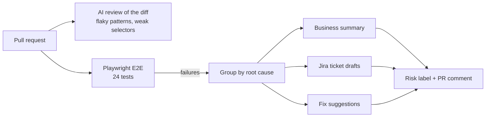

<picture>
  <source media="(prefers-color-scheme: dark)" srcset="./assets/banner-dark.svg">
  <source media="(prefers-color-scheme: light)" srcset="./assets/banner-light.svg">
  
</picture>

  
  
  
  

## About me

I'm a **Senior QA Analyst** with almost 5 years of experience testing systems where bugs cost real money: core banking, multi-country remittances, and B2B telecom. Now I combine that judgment with **test automation** and **AI**.

- 🔍 **Now:** QA on the Salesforce B2B project for Telecom (Personal) at CFOTech. I led the QA team's move to AI agents in Jira for test design, bug reports, docs and log analysis. We went from **~5 test cases/hour to 20+ in minutes**.
- 💸 **Before:** Global66 (fintech, remittances across several countries), where I built Python + Selenium regression suites that ran before every release. Earlier, Banco Patagonia, where I tested core-banking flows on Bantotal and AS/400.
- 🤖 **Building:** Playwright + TypeScript suites with AI in the loop. The AI triages, summarizes and drafts tickets, and I set the rules for what it must never do.

## Featured projects

### 🎭 [Demo-Playwright](https://github.com/JuanEnzetti/Demo-Playwright) — AI-assisted QA pipeline

An E2E suite for SauceDemo, plus a GitHub Actions pipeline where Claude reviews every pull request and turns test failures into decisions people can act on.

| Scope | Details |
|---|---|
| **24** E2E tests | Page Object Model, components, custom fixtures, typed test data |
| **3** CI jobs | AI code review on the diff → E2E run with HTML report → AI quality report on failure |
| **4** AI steps | Group failures by root cause → business summary → Jira ticket drafts → fix suggestions |
| **5** defects found | Real app bugs, documented while exploring before automating |

**Guardrails I wrote for the AI:** never "fix" a test to hide a real app bug; never raise timeouts as the only fix; prefer `getByRole` and `getByTestId`; a slow test gets reported, not healed. Tests are planned and generated with Playwright's planner, generator and healer agents through MCP.

### 🐍 [UI + API automation framework](https://github.com/JuanEnzetti/proyecto-final-automation-testing-Juan-Enzetti) — Python

Selenium + Pytest + Requests. It has Page Object Model, data-driven tests from JSON, parallel runs with `pytest-xdist`, retries for flaky tests, an HTML report and screenshots on every failure. It covers UI on SauceDemo and a REST API on Reqres.

## Tech stack

| Area | Tools |
|---|---|
| **Automation** |     |
| **Languages** |     |
| **AI for QA** |    |
| **APIs & data** |    |
| **CI/CD & cloud** |    |
| **Performance & management** |     |

## GitHub stats

<!--
  These cards come from github-readme-stats. The public instance sometimes hits rate limits.
  If they stop loading, deploy your own copy on Vercel (one click from the project's README)
  and replace "github-readme-stats.vercel.app" with your own domain.
-->

  <picture>
    <source media="(prefers-color-scheme: dark)" srcset="https://github-readme-stats.vercel.app/api?username=JuanEnzetti&show_icons=true&hide_border=true&hide_title=true&theme=github_dark&bg_color=00000000&include_all_commits=true">
    
  </picture>
  <picture>
    <source media="(prefers-color-scheme: dark)" srcset="https://github-readme-stats.vercel.app/api/top-langs/?username=JuanEnzetti&layout=compact&hide_border=true&hide_title=true&theme=github_dark&bg_color=00000000&langs_count=6">
    
  </picture>

## Let's talk

I'm looking for **QA Automation** roles in teams that treat quality as part of the product, not a gate at the end. Find me on [LinkedIn](https://www.linkedin.com/in/juanenzetti/) or by [email](mailto:juancruzenzetti@gmail.com).
